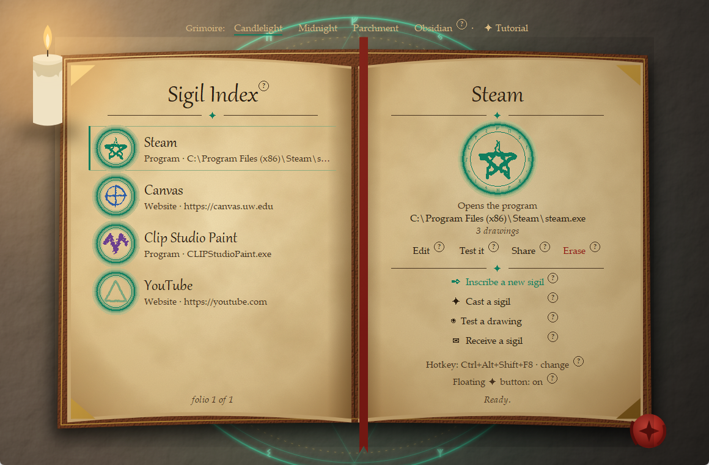
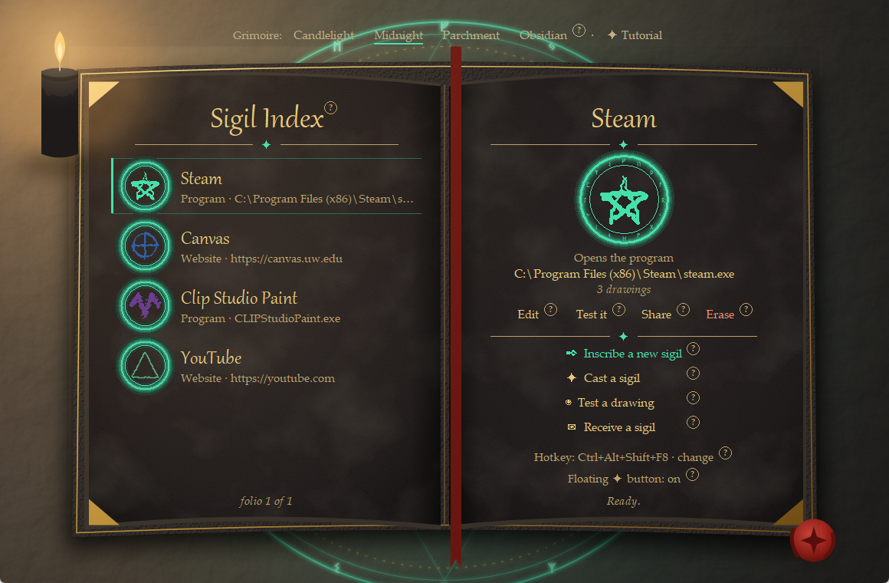

# Desktop Sigil

Draw a sigil on your screen to open a game, an app or a website, like the witches in
*Witch Hat Atelier* drawing spells.

Click the floating ✦ button (or press **Ctrl+Alt+S**), the screen dims, you draw your
sigil with the mouse, and it casts: Steam opens, or Canvas, or your art folder.



**Works on:** Windows 10 and 11. (It doesn't run on Mac or Linux.)

- [Install](#install)
- [First time: the tour](#first-time-the-tour)
- [Make your first sigil](#make-your-first-sigil)
- [Cast a sigil](#cast-a-sigil)
- [Everything else in the Sigil Book](#everything-else-in-the-sigil-book)
- [Share sigils with friends](#share-sigils-with-friends)
- [Troubleshooting](#troubleshooting)
- [Uninstall](#uninstall)
- [For developers](#for-developers)

---

## Install

### The easy way: download the app (no Python needed)

1. Download **`Desktop-Sigil-Windows.zip`** from the
   [Releases page](https://github.com/Jcelestra03/Desktop-Sigil-idea/releases).
2. Right-click the zip → **Extract All…** → **Extract**.
3. Open the new **Desktop Sigil** folder and double-click **Desktop Sigil.exe**.
4. The first time, Windows may show *"Windows protected your PC"*. That's because the app
   isn't signed by a big company, not because something is wrong. Click **More info**,
   then **Run anyway**. It won't ask again.

**Put it on your desktop:** right-click **Desktop Sigil.exe** → *Show more options* →
*Send to* → *Desktop (create shortcut)*. Keep the `_internal` folder next to the .exe;
the app needs it.

**Updating:** download the new zip and replace the folder. Your sigils and settings are
kept in `%APPDATA%\Desktop Sigil`, not in the app folder, so they stay.

### From the source code (if you have Python)

1. Install [Python 3.11 or newer](https://www.python.org/downloads/) (tkinter comes with
   it; nothing else is needed).
2. On this page, click **Code** → **Download ZIP**, and extract it.
3. Double-click **`Desktop Sigil.pyw`**. Your sigils and settings are saved in that folder.

---

## First time: the tour

The first time the Sigil Book opens, it asks **"Want a quick tour?"**

- **Show me around** walks you through the book one part at a time (about a minute). Each
  part is outlined on the page with a card next to it: **Next ▸**, **◂ Back** or **Skip
  tour**.
- At the end you can **try a practice cast**: click **✦ Practice**, draw a circle on the
  dimmed screen and let go. Nothing opens and nothing is saved; the card tells you how
  well it read your circle.
- **Not now** closes it. Click **✦ Tutorial** at the top of the window to see it any time.

**Need a reminder later?** Every button has a small **?** next to it. Hover over it for a
one-line explanation.

**Pick your grimoire** at the top of the window:

| Grimoire | Looks like |
| --- | --- |
| **Candlelight** | Vellum pages by candlelight, over a glowing emerald rune circle |
| **Midnight** | The same scene with black pages and gold ink |
| **Parchment** | Aged pages with red-ink seals, on white fur |
| **Obsidian** | Black pages with gold ink, on teal wood |



---

## Make your first sigil

Click **✒ Inscribe a new sigil** on the right page. A window opens:

1. **Name** it, for example *Steam*.
2. **When I draw it, open a…** choose **Program**, **Website**, **File** or **Folder**.
3. **Pick what it opens:**
   - Program, File or Folder: click **Browse…** and choose it. For a program, pick its
     `.exe` or a shortcut from your desktop or Start menu.
   - Website: type the address, like `canvas.uw.edu` or `youtube.com`.
4. **Choose a pen** (Pen, Brush, Calligraphy, Quill, Marker, Spray or Glow), a **size**
   and an **ink color**. **More…** picks any color. This only changes how it looks.
5. **Draw the sigil** on the big pad and click **Add this drawing**.
   **Do this 3 times, drawing it the same way each time**, so the book learns your shape.
   Made a mistake? **↶ Undo** (or Ctrl+Z) removes the last stroke, **Clear** wipes the
   pad, and clicking a saved drawing removes it.
6. Click **Save sigil**. It appears in your **Sigil Index** on the left page.

**Tips for sigils that are easy to recognize**

- Simple, bold shapes work best: a star, a spiral, a lightning bolt, a letter.
- Make each sigil look clearly different from your others. If two are too alike, the
  book warns you when you save.
- Several strokes are fine, and it doesn't matter which way or in what order you draw them.

---

## Cast a sigil

Use any of these:

- Click the floating **✦ button** (it stays on top of your other windows).
- Press **Ctrl+Alt+S**.
- Click **✦ Cast a sigil** in the Sigil Book.

The screen dims. Draw your sigil with the mouse and let go. A moment later it opens.

| On the dimmed screen | |
| --- | --- |
| Draw | Hold the left mouse button. Several strokes are fine. |
| Cast | Stop drawing for a moment, or press **Enter** |
| Cancel | **Esc** or right-click |

**Keep the Sigil Book open** (minimizing it is fine). The ✦ button and the hotkey only work
while it's running.

---

## Everything else in the Sigil Book

**The Sigil Index (left page)**

- Click a sigil to show its seal on the right page with **Edit**, **Test it**, **Share**
  and **Erase**. Double-click a sigil to edit it.
- More sigils than fit? **turn page ▸** / **◂ turn back**, or scroll the mouse wheel.

**The actions (right page)**

| Button | What it does |
| --- | --- |
| ✒ Inscribe a new sigil | Make a new sigil |
| ✦ Cast a sigil | Dim the screen and draw a sigil to open it |
| ◉ Test a drawing | Like casting, but nothing opens; shows which sigil matched and how closely |
| ✉ Receive a sigil | Add a sigil a friend sent you |
| Edit | Change the name, what it opens, the pen, or its drawings |
| Test it | Check that this sigil is recognized |
| Share | Send this sigil to a friend |
| Erase | Remove it from the book (you're asked first) |

**At the bottom of the right page**

- **Hotkey: Ctrl+Alt+S · change** lets you pick another shortcut, for example
  `ctrl+alt+q` or `win+alt+d`.
- **Floating ✦ button: on/off** shows or hides the button. Drag the button anywhere on
  your screen; right-click it for a menu.

---

## Share sigils with friends

**To send one:** click a sigil in the index, then **Share**. Either:

- **Save .sigil file…** and send the file, or
- **Copy code** and paste it (it starts with `SIGIL1-`) into Discord, a text or an email.
  One code always fits in one Discord message.

**To add one:** click **✉ Receive a sigil**, then open their `.sigil` file or paste their
code (a copied code is filled in for you, even if the chat split it over several lines).

- **Nothing runs when you receive a sigil.** You see what it opens first. Scripts,
  programs in unusual places, and links that open other programs get a warning, and you
  have to tick *I trust who sent this*.
- **It points to your copy.** A program like Discord or Steam is looked for where it's
  installed on *your* PC. If it isn't found, click **Browse…** and pick it.
- **Add your own drawing.** The drawings are your friend's, so leave *Add my own drawing
  after this* ticked to teach the book how *you* draw it.
- Already have a sigil with that name? It's added as "Canvas (2)", or tick *Replace*.

---

## Troubleshooting

| Problem | Fix |
| --- | --- |
| "Windows protected your PC" | Click **More info** → **Run anyway**. It only asks the first time. |
| It says **Hotkey off (Ctrl+Alt+S is taken)** | Another program uses that shortcut. Click the hotkey line and pick another one. |
| Casting says **No sigil recognized** | Draw it bigger and closer to how you saved it. Use **◉ Test a drawing** to practice, or **Edit** the sigil and add another drawing. |
| The wrong sigil opens | Two sigils look too alike. Edit one of them into a more different shape. |
| The ✦ button and hotkey stopped working | The Sigil Book was closed. Open it again (minimized is fine). |
| Nothing happens when I click Cast | Close the open dialog (like the sigil editor) first. |
| The ✦ button disappeared | Turn **Floating ✦ button** back on at the bottom of the right page. |
| A program doesn't open | Click the sigil → **Edit** → **Browse…** and pick the program again (it may have moved). |
| Something went wrong / crashed | A message shows where the details were saved (`sigil-error.log`). Send that file to us. |

---

## Uninstall

1. Delete the **Desktop Sigil** folder (and its desktop shortcut, if you made one).
2. To also remove your sigils and settings, delete `%APPDATA%\Desktop Sigil`: paste that
   into the File Explorer address bar and press Enter, then delete the folder.

Nothing else is installed, and nothing is added to the registry.

---

## For developers

Python 3.11+, standard library only (tkinter, ctypes). See [`PLAN.md`](PLAN.md) for the
plan and who owns what, [`LOG.md`](LOG.md) for what's changed, and
[`CLAUDE.md`](CLAUDE.md) for the rules our coding agents follow.

**Command line:** everything in the window can also be done from a terminal:

```bash
python -m sigil                                   # open the Sigil Book (same as double-click)
python -m sigil run                               # hotkey only, no window
python -m sigil add "Canvas" --url https://canvas.uw.edu
python -m sigil add "Notepad" --app notepad.exe
python -m sigil list
python -m sigil remove "Canvas"
python -m sigil test
python -m unittest                                # run the tests
```

Run from source, sigils and settings are saved in `sigils.json` and `settings.json` next
to this README (set `SIGIL_FILE` to keep them somewhere else). Neither is committed to git.

**Building the .exe:** `python build_exe.py` packs the app and Python into
`dist/Desktop Sigil/` with [PyInstaller](https://pyinstaller.org) and zips it as
`dist/Desktop-Sigil-Windows.zip`, ready to attach to a GitHub Release. PyInstaller is only
needed to build (`python -m pip install pyinstaller`). `build/` and `dist/` are gitignored.

**The painted grimoires:** Candlelight and Midnight are painted pictures (tkinter can't do
soft light or paper grain). `python tools/render_art.py` draws each as an SVG and has
Microsoft Edge save it as PNGs in `assets/grimoire/`, at a few sizes; the app picks the one
that fits the window and draws the text and buttons on top (`sigil/artbook.py`). Edge is
only needed to re-render the art, never to run the app. The icon is drawn by
`tools/make_icon.py`.

**How recognition works:** each drawing is turned into a cloud of 32 evenly spaced points,
scaled and centered, and compared to every saved drawing with the
[$P point-cloud recognizer](https://depts.washington.edu/acelab/proj/dollar/pdollar.html).
Because it compares point clouds, stroke order and direction don't matter.

## Team

Jcelestra03 and Tifanie, TCSS 490 Fall 2026.
